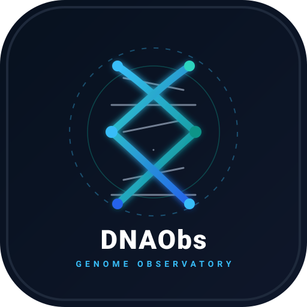

# DNAObs Google Gemini & Antigravity Plugin

<p align="center">
  
</p>

<p align="center">
  <strong>The official Google Gemini and Antigravity extension for DNAObs — the secure DNA data hub center.</strong>
</p>

<p align="center">
  <a href="https://dnaobs.com"></a>
  <a href="https://github.com/Guydesalomon/dnaobs-gemini-plugin"></a>
  <a href="LICENSE"></a>
</p>

---

## 🧬 Overview

**DNAObs** is a personal genomics data hub center where users upload raw genotype data (from 23andMe, AncestryDNA, MyHeritage, FamilyTreeDNA, Living DNA, or VCF) to explore ancestry, health markers, trait phenotypes, and maternal/paternal lineages while retaining complete privacy and data ownership.

This official plugin connects Google Gemini, Antigravity, and AI agents directly to the live DNAObs knowledge base and real-time analysis pipeline status over the Model Context Protocol (MCP).

---

## 🚀 Installation

### In Google Gemini CLI
```bash
gemini extensions install Guydesalomon/dnaobs-gemini-plugin
```

### In Google Antigravity IDE
Clone or copy into your user plugins directory:
```bash
git clone https://github.com/Guydesalomon/dnaobs-gemini-plugin.git ~/.gemini/config/plugins/dnaobs
```

---

## 🛠 Available Tools

All tools are read-only, idempotent, and backed by the live remote MCP server at `https://dnaobs.com/mcp`:

1. **`search_guides`**: Search public DNAObs help guides about upload preparation, provider file compatibility, ancestry features, report navigation, and privacy policy.
2. **`get_guide`**: Read full official documentation on:
   - `getting-started` (onboarding and upload walkthrough)
   - `file-formats` (raw TXT, CSV, TSV, VCF specifications)
   - `report-navigation` (finding reports, dashboard access)
   - `ancestry-tools` (autosomal models, Y-DNA / mtDNA haplogroups)
   - `privacy-support` (account deletion, encryption, retention)
   - `analysis-availability` (timing heuristics and queue depth)
3. **`check_analysis_availability`**: Fetch live operational status and estimated processing duration from active DNAObs worker clusters.

---

## 📁 Supported Raw DNA Formats

- **23andMe**: `.txt`, `.csv`, `.tsv` (Builds 36, 37/hg19, 38)
- **AncestryDNA**: `.txt`, `.csv`, `.tsv`
- **MyHeritage**: `.csv`, `.txt`
- **FamilyTreeDNA**: Concatenated autosomal `.csv`, `.txt`
- **Living DNA**: Standard autosomal `.csv`, `.txt`
- **Whole Genome / VCF**: Single-sample GRCh38 VCF with reference alleles
- **Compressed Archives**: `.zip` or `.gz` containing exactly one supported DNA file (up to 64 MiB decompressed)

---

## 🛡️ Safety & Privacy Guardrails

- **Zero In-Chat File Uploads**: Genotype data and sequencing files must never be pasted or collected in chat. All uploads take place in the authenticated browser session at [dnaobs.com/dna-analysis](https://dnaobs.com/dna-analysis).
- **Non-Diagnostic**: DNAObs is for educational, personal research, and self-discovery purposes. It does not provide medical diagnoses or replace genetic counseling.
- **Privacy First**: This connector has no access to private user reports or credentials.

---

## 📄 License

This connector plugin is open source under the [MIT License](LICENSE). DNAObs analysis services, proprietary bioinformatics pipelines, and cloud platform remain proprietary to [DNAObs](https://dnaobs.com).
